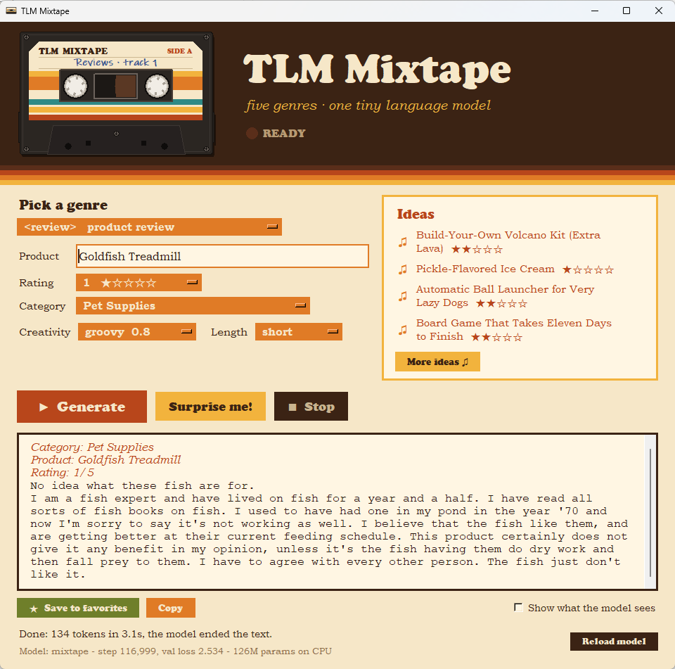

# TLM — Tiny Language Model

A complete GPT-style transformer built from scratch in PyTorch, small enough
to train on a CPU (Stages 1–3) or a modest GPU (Stage 4), written to be
**read**. Every file is heavily commented, and the `docs/` folder is a
chapter-by-chapter walkthrough of how and why it all works.

**Note from elkayem:** This project was created entirely by Claude Fable 5 based on my prompts. 
My goal was to create an LLM that was simple enough for me to train on my home PC, and 
commented well enough that I could understand the inner mechanics. -Larry

## The four models

| | Stage 1: `shakespeare` | Stage 2: `stories` | Stage 3: `instruct` | Stage 4: `mixtape` |
|---|---|---|---|---|
| Dataset | Tiny Shakespeare (~1 MB) | TinyStories (~1.9 GB) | TinyStories-Instruct (~2.7 GB) | five tagged genres of real English: Wikipedia, old books, product reviews, recipes, stories (~2.5B tokens) |
| Tokenizer | character-level (65 tokens) | BPE, trained from scratch (4096) | new BPE (4096) + `<\|endoftext\|>` special token | new BPE (16,384) + `<\|endoftext\|>` + five genre tags |
| Size | ~2.7M parameters | ~7.4M parameters | ~27M parameters | ~126M parameters |
| Context | 256 tokens | 256 tokens | 512 tokens | 1,024 tokens |
| Training time | 2 hours (CPU); 4 minutes on the GPU† | 56 hours (CPU, the long weekend); ~1.5 hours on the GPU† | 118 hours (CPU, 5 days); ~4 hours on the GPU† | 109 hours (GPU, RTX 3050): 79,000 steps, then extended to 117,000 |
| Best val loss | 1.609 | 1.595 | 1.257* | 2.565*‡ (2.586 before the extension) |
| What you get | fake Shakespeare | coherent little children's stories | stories to order: give it a summary, required words, or features | articles, novels, reviews, recipes and stories on any premise — and deliberate genre collisions (a recipe for "The French Revolution") |

\* Not comparable across columns: each model is scored under its own
tokenizer and dataset, which changes what "loss per token" means.

‡ The average of the five genres' losses, measured on the same 60
validation passages for every checkpoint (Stage 4 mixes genres whose
losses range from ~1.4 for recipes to ~3.2 for old books). The story of
the run, including a loss spike and its repair, is in
[docs/10-mixtape.md](docs/10-mixtape.md).

† Measured on an NVIDIA RTX 3050 (6 GB) with `tools/benchmark_gpu.py`.
Stage 1 ran in full: 4 minutes, reaching a val loss of 1.606 against the
CPU run's 1.609. Stages 2 and 3 ran 2,000 steps each, and the full-run
time comes from their sustained speed (evals and samples included):

| | tokens/s, CPU | tokens/s, GPU | speed-up | GPU work rate |
|---|---|---|---|---|
| Stage 1 (2.7M) | ~5,700 | 173,000 | 30× | ~3.4 TFLOPS |
| Stage 2 (7.4M) | ~2,450 | 89,000 | 36× | ~4.5 TFLOPS |
| Stage 3 (27M) | ~1,250 | 37,000 | 30× | ~7.0 TFLOPS |
| Stage 4 (126M) | — | 9,700 | — | ~9 TFLOPS |

The work rate (floating-point operations per second actually achieved)
climbs with model size: small models' narrow matrices can't keep a GPU
fully busy.

Stage 1 is the fast feedback loop for learning the architecture. Stage 2 is
the payoff: the TinyStories dataset was designed (Eldan & Li 2023) so that
even single-digit-million-parameter models learn grammar, plot, and
character consistency. Stage 3 crosses from *completing* text to *following
instructions* — same loss, differently formatted data (see
[docs/08-instruct.md](docs/08-instruct.md)) — and adds fine-tuning: the 7.4M
stories model gets adapted to the instruct format as a warm-up baseline.
Stage 4 moves to a GPU ([docs/09-gpu.md](docs/09-gpu.md)) and to real
English: a ~126M model trained on a *mixture* of five sources, each
document tagged with its genre, so the tag becomes a dial at generation
time ([docs/10-mixtape.md](docs/10-mixtape.md)). It comes with a desktop
app for playing with it.

The Stage 1–3 numbers are measured results from the CPU of an Intel Core
Ultra 7 265 (20 cores). The machine has since gained an NVIDIA RTX 3050
(6 GB), and TLM now trains on it automatically when the CUDA build of
PyTorch is installed. On the Stage 3 model it runs ~30× faster: 37,000 vs
~1,250 tok/s, so the 5-day run becomes ~4 hours. Here's a sample from
the finished stories model:

> Once upon a time, there was a little girl named Lily. She loved to play
> with her toys and eat candy. One day, she went to the park to play with
> her friends. They were having fun, but then Lily saw a butterfly. She
> wanted to catch it, but the butterfly flew away.

## Setup

Create a venv **outside** synced folders like OneDrive (with the GPU build
of PyTorch it's ~3 GB), then install one of the two PyTorch builds:

```
python -m venv %USERPROFILE%\tlm-venv
%USERPROFILE%\tlm-venv\Scripts\activate

rem NVIDIA GPU (~1.9 GB download):
pip install -r requirements.txt --extra-index-url https://download.pytorch.org/whl/cu130
rem ...or CPU only (much smaller; Stages 1-3 were trained this way):
pip install -r requirements.txt --extra-index-url https://download.pytorch.org/whl/cpu

python -c "import torch; print(torch.__version__, torch.cuda.is_available())"
```

The last line should print `2.13.0+cu130 True` with the GPU build.

- **Drivers.** The `cu130` build needs an NVIDIA driver that supports CUDA
  13.0; `nvidia-smi` shows the highest version yours supports (top
  right). With an older driver, use an older build from the same index,
  e.g. `cu126`.
- **Already have a CPU venv?** Switch it with
  `pip install "torch==2.13.0+cu130" --index-url https://download.pytorch.org/whl/cu130`.
- **Choosing the device.** `tlm.train` and `tlm.generate` take
  `--device auto|cuda|cpu`. `auto` (the default) uses the GPU when PyTorch
  can see one, else the CPU. Checkpoints move freely between the two,
  including `--resume` and `--init-from`.
- **Where things live.** Datasets go to `~/tlm-data/<name>/` and
  checkpoints to `~/tlm-checkpoints/<run>/` (`%USERPROFILE%\...` on
  Windows), deliberately outside the repo: they're large and rewritten
  often, which a synced folder would upload over and over. Set
  `TLM_DATA_DIR` / `TLM_CKPT_DIR` to put them elsewhere. Datasets prepared
  by older versions inside the repo's `data/<name>/` folder are still
  found there. Each run folder holds `best.pt` (lowest val loss),
  `latest.pt` (most recent, used by `--resume`) and `log.csv` (step, lr,
  losses, throughput — for plotting).

## Quickstart

All commands run from this `tlm/` directory with the venv activated (or
call its python directly).

```
# Stage 1 --------------------------------------------------------
python data\prepare_shakespeare.py          # download + tokenize (seconds)
python -m tlm.train --config shakespeare    # ~2 hours on a CPU; safe to Ctrl+C
python -m tlm.generate --run shakespeare --prompt "ROMEO:" --tokens 400

# Stage 2 --------------------------------------------------------
python data\prepare_stories.py              # ~2GB download + BPE (run overnight)
python -m tlm.train --config stories        # the weekend run (on a CPU)
python -m tlm.train --config stories --resume    # continue after interruption
python -m tlm.generate --run stories --prompt "Once upon a time"

# Stage 3: instruction following (see docs/08-instruct.md + PLAN-stage3.md)
python data\prepare_instruct.py             # ~2.7GB download + encode (hours)
python -m tlm.train --config instruct-ft --init-from stories   # fine-tune warm-up
python -m tlm.train --config instruct-pilot                    # measure s/step
python -m tlm.train --config instruct                          # the week-long run

# Stage 4: the Mixtape, on a GPU (docs/09-gpu.md, docs/10-mixtape.md, PLAN-stage4.md)
python data\prepare_mixtape.py --small      # optional: a ~5M-token test run (minutes)
python -m tlm.train --config mixtape-smoke  #   ...and a toy model trained on it
python data\prepare_mixtape.py              # ~35 GB download + prep (~1 hour)
python data\prepare_mixtape.py inspect      # look at the result
python -m tlm.train --config mixtape-pilot  # ~30 min: speed + memory check
tools\train_mixtape.cmd                     # the ~3-day run (double-clickable)
tools\track_fixed_eval.cmd                  # score each checkpoint on fixed passages
python tools\make_shortcut.py               # put the Mixtape app on the desktop
python tools\plot_mixtape_run.py            # redraw docs/mixtape-run.svg from the logs
python tools\sample_sheet.py CKPT --out samples.md        # fixed-seed sample sheet
python tools\sample_sheet.py A.pt --compare B.pt --out blind.md   # blind A/B test
```

While training, a text sample is printed every 500–1000 steps — watching the
output evolve from noise → words → sentences is the best part; keep notes in
[JOURNAL.md](JOURNAL.md). Stage 4's samples take turns through a bank of
genre prompts (`MIXTAPE_PROMPTS` in `config.py`).

**Stage 4 data prep** (`data\prepare_mixtape.py`) runs five stages —
download, format, tokenizer, encode, mix — that can also be named one at a
time (`python data\prepare_mixtape.py format encode`); each skips work
already done, so re-running after an interruption resumes.

- **RecipeNLG is a manual download:** accept the terms at
  [recipenlg.cs.put.poznan.pl](https://recipenlg.cs.put.poznan.pl/),
  download `dataset.zip`, and put it (or the `full_dataset.csv` inside) in
  `~/tlm-data/mixtape-raw/recipenlg/`. The other genres download and format
  without it; the tokenizer stage waits for it. If the site fails (it
  returned "Internal Server Error" in October 2026), an exact copy is on
  Hugging Face:
  [SandhyaKilari/RecipeNLG_dataset](https://huggingface.co/datasets/SandhyaKilari/RecipeNLG_dataset)
  (`RecipeNLG_dataset.csv`, the same 2,231,142 recipes; unofficial, so
  RecipeNLG's terms still apply).
- **Disk and time** (measured on the dev machine): raw downloads 35 GB and
  the dataset folder 22 GB, so have ~60 GB free. Downloads take ~30 min
  at ~20 MB/s; format ~20 min, tokenizer seconds, encode ~3 min, mix
  ~3.5 min. After training, `~/tlm-data/mixtape/formatted/` and
  `~/tlm-data/mixtape-raw/` can be deleted to get ~45 GB back (keep
  `tokens/` if you might re-mix).
- **Changing the mixture** is cheap: edit `TRAIN_TOKENS` in the script,
  delete `train.bin`, re-run `mix`.

**Long runs:** set your power settings so the PC doesn't sleep. Runs
checkpoint every 1000 steps (~50 min for Stage 2 on the CPU, ~1 hour for
Stage 4 on the GPU), so an interruption costs at most that, and `--resume`
picks up where it stopped (including the elapsed-time clock). For Stage 4,
`tools\train_mixtape.cmd` does this for you: double-click it to start the
run in its own window, and again after any restart — it adds `--resume`
when a checkpoint exists, and copies everything the run prints to
`~/tlm-data/mixtape-train.log`. (`TLM_PYTHON` overrides which python it
uses; the default is `%USERPROFILE%\tlm-venv`.) Start it from Explorer,
not from inside another app's terminal or an AI assistant: a program
started by an app can be stopped with it (a Claude app update stopped the
Stage 4 run once). Extra options pass through to `train.py`, e.g.
`tools\train_mixtape.cmd --rewarm 500`. If the GPU runs out of memory
(it also drives the desktop, and other programs can take some), the step
is retried after a minute; if training crashes anyway, the launcher
resumes from the last checkpoint by itself after 2 minutes, up to 10
times. Closing GPU-hungry programs during a long run helps (Edge keeps
running in the background with "startup boost" on).

**Watching a long run.** Each eval logs the gradient norm and the largest
attention score (`grad_norm`, `grad_norm_max`, `attn_score_max` in
`log.csv`, and a "health" line in the output): a gradient norm that keeps
climbing, or attention scores heading into the thousands, are early
warnings of a loss spike. New runs evaluate on the same batches every time
(`fixed_eval`), so the log shows trends rather than luck, and `best.pt`
follows the average of the per-genre val losses when a dataset has them.
`snapshot_interval` keeps a full checkpoint every N steps (the newest
`snapshots_kept`) in `snapshots/`, so there's always something to roll
back to.

**Attention stability.** New models use QK-norm (`qk_norm`, on by
default; the Stage 1–3 presets keep it off and load exactly as before).
`python tools\add_qk_norm.py SRC.pt DST.pt --layers 1 --fresh-optimizer`
grafts it onto a checkpoint trained without it; resume that with
`--rewarm N` (see docs/10-mixtape.md for the whole story).

**Extending a finished run:** raise `max_steps` and set `restart_step`
(the old last step), `restart_lr` (the rewarm peak) and `restart_warmup`
in its preset, then resume. Keep a copy of the old final checkpoint to
compare against.

## The Mixtape app

A small desktop window for playing with the Stage 4 model: pick a genre,
click one of four rotating ideas (or type your own), press Generate, and
watch it write word by word.



*Asked for a 1-star review of a Goldfish Treadmill, the model wrote this
in 3 seconds on the CPU. "I am a fish expert and have lived on fish for a
year and a half."*

Getting started: `python tools\make_shortcut.py` (run with the
venv's python) puts a **TLM Mixtape** shortcut on the desktop — it asks
Windows where the desktop is, which matters when OneDrive has moved it;
re-run it if the repo or venv moves. Or start it with `python -m tlm.gui`
(`--run NAME`, `--device cpu|cuda`).

- It loads the first of `mixtape`, `mixtape-pilot`, `mixtape-smoke` that
  has a `best.pt`; **Reload model** picks up a newer one mid-training. It
  uses the GPU if ≥ 1.5 GB is free, otherwise the CPU — so it can run
  alongside a training run.
- It's dressed as a 1970s mixtape: while the model writes, the cassette's
  reels turn, the tape winds from one reel to the other, and the REC light
  blinks. **Creativity** is the sampling temperature, with 70s names:
  mellow 0.6, groovy 0.8, far out 1.0, cosmic 1.2.
- Each genre has a small form (a title; a product, star rating and
  category; a premise) that the app turns into the exact document header
  the model was trained on. Tick **Show what the model sees** to see it.
- The ideas are in [tlm/ideas.json](tlm/ideas.json) — add your own; about
  a quarter are deliberate genre collisions.
- **Save to favorites** appends to `favorites.md` in the repo (a laugh log
  worth committing). The idea deck's state goes to
  `~/tlm-data/gui_state.json`, errors to `~/tlm-data/gui.log`.
- Tkinter comes with the python.org Windows installer (the "tcl/tk and
  IDLE" option, on by default): nothing to pip install.
  `python tools\make_icon.py` redraws the cassette icon.

## The guided tour (docs/)

Start with the [architecture figure](docs/architecture.svg) — the whole
model on one page, from token ids down to the causal attention matrix.
Then read in order, next to the code file each chapter covers:

1. [00-overview.md](docs/00-overview.md) — the big picture: what a language model is
2. [01-tokenization.md](docs/01-tokenization.md) — text → integers (`tokenizer.py`)
3. [02-embeddings.md](docs/02-embeddings.md) — integers → vectors (`model.py: TLM.__init__`)
4. [03-attention.md](docs/03-attention.md) — the heart of it (`model.py: CausalSelfAttention`)
5. [04-transformer-block.md](docs/04-transformer-block.md) — MLP, residuals, LayerNorm (`model.py: Block`)
6. [05-full-model.md](docs/05-full-model.md) — assembling TLM (`model.py: TLM`)
7. [06-training.md](docs/06-training.md) — the training loop (`train.py`)
8. [07-sampling.md](docs/07-sampling.md) — generating text (`generate.py`, `TLM.generate`)
9. [08-instruct.md](docs/08-instruct.md) — Stage 3: instruction following, special tokens, fine-tuning
10. [09-gpu.md](docs/09-gpu.md) — Stage 4a: devices, mixed precision, fused attention, gradient accumulation
11. [10-mixtape.md](docs/10-mixtape.md) — Stage 4: data mixtures, control tokens, a faster BPE trainer, the KV cache and the app; a loss spike diagnosed and repaired with QK-norm

## Layout

```
tlm/
├── README.md            you are here
├── JOURNAL.md           training diary: samples as the models learned
├── PLAN-stage3.md       instruction-following (~25M params), done
├── PLAN-stage4.md       the GPU port + TLM-Mixtape (~126M)
├── favorites.md         the Mixtape app's saved favorites (once you save one)
├── docs/                the textbook + architecture figure
├── tlm/
│   ├── config.py        all hyperparameters + presets; where data and checkpoints live
│   ├── tokenizer.py     char + from-scratch BPE (and its fast trainer)
│   ├── model.py         the transformer (start reading here)
│   ├── train.py         training loop, checkpointing, logging
│   ├── generate.py      sampling CLI
│   ├── gui.py           the Mixtape desktop app
│   └── ideas.json       the app's idea bank
├── data/
│   ├── prepare_shakespeare.py
│   ├── prepare_stories.py
│   ├── prepare_instruct.py
│   └── prepare_mixtape.py
├── tools/
│   ├── train_mixtape.cmd/.ps1   start or resume the Stage 4 run
│   ├── track_fixed_eval.py/.cmd score each checkpoint on fixed val passages
│   ├── add_qk_norm.py           graft QK-norm onto a trained checkpoint
│   ├── sample_sheet.py          fixed-seed samples; blind A/B comparisons
│   ├── plot_mixtape_run.py      draws docs/mixtape-run.svg
│   ├── after_run.py             compare a finished run's model with a baseline
│   ├── benchmark_gpu.py         measure Stages 1-3's GPU training speed
│   ├── gpu_health.cmd/.ps1      GPU temperature/health log during a run
│   ├── mixtape_status.ps1       one-shot health report of the Stage 4 run
│   ├── make_shortcut.py         desktop shortcut for the app
│   └── make_icon.py             draws assets/mixtape.ico
├── assets/              the app icon
└── weights/             archived weights-only exports (gitignored)

~/tlm-data/              datasets, raw downloads, app state (outside the repo)
~/tlm-checkpoints/       full checkpoints, outside the repo (see Setup)
```

## References

All links verified. Each paper below is the origin of something you can
point to in this repo's code.

### Datasets

- **Tiny Shakespeare** — from Andrej Karpathy's
  [char-rnn](https://github.com/karpathy/char-rnn) repository (2015, MIT
  license), introduced alongside the blog post
  ["The Unreasonable Effectiveness of Recurrent Neural Networks"](https://karpathy.github.io/2015/05/21/rnn-effectiveness/).
- **TinyStories** and **TinyStories-Instruct** — Ronen Eldan & Yuanzhi Li,
  ["TinyStories: How Small Can Language Models Be and Still Speak Coherent
  English?"](https://arxiv.org/abs/2305.07759) (2023). Datasets on Hugging
  Face: [roneneldan/TinyStories](https://huggingface.co/datasets/roneneldan/TinyStories),
  [roneneldan/TinyStoriesInstruct](https://huggingface.co/datasets/roneneldan/TinyStoriesInstruct)
  (CDLA-Sharing-1.0 license).
- **Wikipedia** (Stage 4 `wiki`) — the
  [wikimedia/wikipedia](https://huggingface.co/datasets/wikimedia/wikipedia)
  dump of 1 November 2023, English (CC BY-SA 3.0 / GFDL).
- **PG-19** (Stage 4 `book`) — Rae et al.,
  ["Compressive Transformers for Long-Range Sequence
  Modelling"](https://arxiv.org/abs/1911.05507) (2019): 28,602 Project
  Gutenberg books published before 1919
  ([google-deepmind/pg19](https://github.com/google-deepmind/pg19), Apache
  2.0; the books are public domain).
- **Amazon Reviews 2023** (Stage 4 `review`) — Hou et al.,
  ["Bridging Language and Items for Retrieval and
  Recommendation"](https://arxiv.org/abs/2403.03952) (2024); data at
  [McAuley-Lab/Amazon-Reviews-2023](https://huggingface.co/datasets/McAuley-Lab/Amazon-Reviews-2023)
  (no license stated, so the data and anything trained on it stays local).
- **RecipeNLG** (Stage 4 `recipe`) — Bień et al.,
  ["RecipeNLG: A Cooking Recipes Dataset for Semi-Structured Text
  Generation"](https://aclanthology.org/2020.inlg-1.4/) (INLG 2020); terms
  of use on [the project site](https://recipenlg.cs.put.poznan.pl/).
- **WritingPrompts** (Stage 4 `story`) — Fan, Lewis & Dauphin,
  ["Hierarchical Neural Story Generation"](https://aclanthology.org/P18-1082/)
  (ACL 2018); the Hugging Face copy used here is
  [euclaise/writingprompts](https://huggingface.co/datasets/euclaise/writingprompts).

### Architecture

- Vaswani et al., ["Attention Is All You Need"](https://arxiv.org/abs/1706.03762)
  (2017) — the transformer: scaled dot-product attention, multi-head
  attention, the 4× MLP (`model.py` throughout).
- Radford et al., ["Language Models are Unsupervised Multitask
  Learners"](https://cdn.openai.com/better-language-models/language_models_are_unsupervised_multitask_learners.pdf)
  (2019) — GPT-2, the decoder-only recipe TLM follows: pre-norm blocks,
  learned positions, the init scheme, BPE at scale.
- Sennrich, Haddow & Birch, ["Neural Machine Translation of Rare Words with
  Subword Units"](https://arxiv.org/abs/1508.07909) (2015) — byte-pair
  encoding for tokenization (`tokenizer.py: BPETokenizer`).
- He et al., ["Deep Residual Learning for Image
  Recognition"](https://arxiv.org/abs/1512.03385) (2015) — residual
  connections (`model.py: Block`, the `x = x + f(x)` pattern).
- Ba, Kiros & Hinton, ["Layer Normalization"](https://arxiv.org/abs/1607.06450)
  (2016) — LayerNorm (`ln1`/`ln2`/`ln_f`).
- Hendrycks & Gimpel, ["Gaussian Error Linear Units
  (GELUs)"](https://arxiv.org/abs/1606.08415) (2016) — the MLP's
  activation function.
- Press & Wolf, ["Using the Output Embedding to Improve Language
  Models"](https://arxiv.org/abs/1608.05859) (2016) — weight tying between
  the embedding and the output head.
- Dao et al., ["FlashAttention: Fast and Memory-Efficient Exact Attention
  with IO-Awareness"](https://arxiv.org/abs/2205.14135) (2022) — attention
  computed in tiles without storing the full matrix, the idea behind the
  fused `scaled_dot_product_attention` (`model.py: CausalSelfAttention`).
- Keskar et al., ["CTRL: A Conditional Transformer Language Model for
  Controllable Generation"](https://arxiv.org/abs/1909.05858) (2019) —
  control codes: steering generation with source tags, the idea behind
  Stage 4's genre tags.
- Henry et al., ["Query-Key Normalization for
  Transformers"](https://arxiv.org/abs/2010.04245) (2020), and Dehghani et
  al., ["Scaling Vision Transformers to 22 Billion
  Parameters"](https://arxiv.org/abs/2302.05442) (2023) — QK-norm, and the
  attention logit growth it prevents (`model.py: CausalSelfAttention`).

### Training & sampling

- Kingma & Ba, ["Adam: A Method for Stochastic
  Optimization"](https://arxiv.org/abs/1412.6980) (2014) and Loshchilov &
  Hutter, ["Decoupled Weight Decay Regularization"](https://arxiv.org/abs/1711.05101)
  (2017) — the AdamW optimizer (`train.py`).
- Hoffmann et al., ["Training Compute-Optimal Large Language
  Models"](https://arxiv.org/abs/2203.15556) (2022) — "Chinchilla" scaling:
  the ~20-tokens-per-parameter rule used to size the Stage 3 and Stage 4
  runs.
- Micikevicius et al., ["Mixed Precision Training"](https://arxiv.org/abs/1710.03740)
  (2017) — training in 16-bit floats with fp32 master weights; Stage 4 uses
  the bfloat16 variant (`train.py: autocast_for`).
- Muennighoff et al., ["Scaling Data-Constrained Language
  Models"](https://arxiv.org/abs/2305.16264) (2023) — repeating data for up
  to ~4 passes is nearly as good as fresh data; the basis for repeating the
  smaller Stage 4 sources.
- Wortsman et al., ["Small-scale proxies for large-scale Transformer
  training instabilities"](https://arxiv.org/abs/2309.14322) (2023) —
  attention logit growth reproduced in small models at high learning
  rates; what Stage 4's first run ran into.
- Ibrahim et al., ["Simple and Scalable Strategies to Continually
  Pre-train Large Language Models"](https://arxiv.org/abs/2403.08763)
  (2024) — re-warming and re-decaying the learning rate to keep training
  a finished model (Stage 4's extension).
- Holtzman et al., ["The Curious Case of Neural Text
  Degeneration"](https://arxiv.org/abs/1904.09751) (2019) — nucleus (top-p)
  sampling and why greedy decoding degenerates (`model.py: generate`).

The project's spiritual ancestors are Karpathy's
[char-rnn](https://github.com/karpathy/char-rnn) and
[nanoGPT](https://github.com/karpathy/nanoGPT) — TLM is an independent
implementation in the same teach-by-reading tradition.
