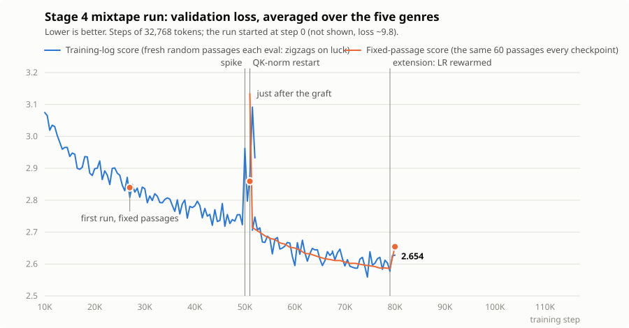

# Chapter 10 — Stage 4: the Mixtape (data mixtures and control tokens)

*Code: `data/prepare_mixtape.py`; `BPETokenizer.train_fast` in
`tokenizer.py`; the `mixtape*` presets and `MIXTAPE_PROMPTS` in
`config.py`; per-genre validation in `train.py`; `TLM.generate_stream` in
`model.py`; the desktop app in `gui.py`. For "The run": QK-norm in
`CausalSelfAttention` (`model.py`), `tools/add_qk_norm.py`,
`tools/track_fixed_eval.py`, `tools/plot_mixtape_run.py`,
`tools/sample_sheet.py`*

Stages 2 and 3 learned from one tidy synthetic dataset. Stage 4 learns
from real English — five very different sources, ~2.5 billion tokens — with
a 126M-parameter model (16 layers × 768 wide, 1,024-token context), about
4.6× Stage 3. Two ideas carry the stage:

> **1. A model is its data, and real models are trained on *mixtures*:
> how much of each source goes in is a design decision.**
>
> **2. Tag every document with its source, and the tag becomes a dial
> you can turn at generation time.**

The second is the "control code" trick of CTRL (Keskar et al. 2019),
shrunk to fit one small GPU. And there's a third, less academic goal: the
Stage 2 stories were funny because a small model nails a familiar format
while getting the details confidently wrong. Stage 4 is built to aim that
at things that don't exist.

## The five genres

Every training document starts with one of five genre tags — special
tokens, atomic like `<|endoftext|>` in chapter 8 — then a short header,
then the text:

```
<|wiki|> Title: Piaohao
Piaohao (literally 'draft banks'), ... were a type of bank that existed in China ...<|endoftext|>
<|review|> Category: Pet Supplies
Product: Maggii 9 Inch Grunting Latex Rubber Dog Toy Polka Dot Pig Dog Toy, Red
Rating: 1/5
Not durable
Purchased as a Christmas gift for my 10 mo old Husky. She ripped it to shreds in under 10 minutes.<|endoftext|>
<|recipe|> Title: Creamy Potato Soup
Ingredients:
- 6 bacon slices, cooked
...
Directions:
1. In large saucepan, cook onions ...<|endoftext|>
```

| tag | source | what it brings |
|---|---|---|
| `wiki` | English Wikipedia (10 of 41 shards) | facts, a deadpan encyclopedia voice, names of real things |
| `book` | PG-19: 28,602 Gutenberg books published before 1919 | narrative, dialogue, an old-fashioned literary voice |
| `review` | Amazon Reviews 2023: Pet Supplies, Toys and Games, Grocery | a shopper's voice; star rating → opinion |
| `recipe` | RecipeNLG: 1.6M recipes | ingredient lists, numbered steps |
| `story` | WritingPrompts: 303k Reddit stories, each answering a prompt | turning a premise into a story |

Book headers are `Title: <title> by <author>` (from PG-19's metadata), so
an author's name is a style dial too. Story headers are
`Prompt: <premise>`.

## Building a mixture

`prepare_mixtape.py` runs five stages, each skipping work already done:

```
download -> format -> tokenizer -> encode -> mix
 35 GB       11 GB      16,384      5.5 GB    5 GB train.bin
 ~30 min    ~20 min    seconds     ~3 min    ~3.5 min
```

The interesting decisions are all in **format** and **mix**:

- **Plain ASCII.** Real text is full of curly quotes, accents, emoji and
  other alphabets. A from-scratch tokenizer spends vocabulary on every
  distinct character it sees, so everything is mapped to ASCII (curly
  quotes to straight ones, `é` to `e`), and documents that are mostly
  *not* Latin text are dropped, as is anything failing a cheap English
  check (" the", " and", " of", " to" should be ≥ 3% of the words).
- **Chunking with repeated headers.** Training samples random 1,024-token
  windows. A window from the middle of a 70,000-word novel would usually
  contain no tag at all, and the model would never learn what `<|book|>`
  means. So long texts are cut at paragraph breaks into pieces of ≤ 3,500
  characters (~850 tokens), and *every* piece starts with the tag and
  title again.
- **Rebalancing review ratings.** About 65% of real reviews are 5 stars.
  Train on that and `Rating:` barely matters; the model learns "reviews
  are positive." The format stage keeps every 1–3-star review, 60% of the
  4s and 20% of the 5s, which brings 5-star down to ~30%. (The 1-star
  reviews are where the comedy is, anyway.)
- **Shares.** Wikipedia and books are the backbone (55%) because the
  genre collisions are only funny if the model knows about the world; the
  three playful formats get far more than their natural share. A source
  smaller than its share is repeated — Muennighoff et al. (2023) found up
  to ~4 passes over the same data are nearly as good as fresh data.
- **Shuffle and hold out.** Mix shuffles all 8.6M chosen documents of all
  genres together into one `train.bin`, after setting aside 1.5M random
  tokens *per genre* as validation data the model never trains on.

The result:

| genre | train tokens | share | passes | val tokens | tokens/doc |
|---|---|---|---|---|---|
| wiki | 750M | 30% | 0.84 | 1.5M | 577 |
| book | 625M | 25% | 0.74 | 1.5M | 804 |
| review | 500M | 20% | 0.80 | 1.5M | 119 |
| recipe | 375M | 15% | 1.17 | 1.5M | 197 |
| story | 250M | 10% | 1.05 | 1.5M | 582 |

2.5B tokens is ~20 per parameter — chapter 8's Chinchilla rule again.
Changing the recipe is cheap: edit `TRAIN_TOKENS`, delete `train.bin`,
re-run `mix` (minutes, no re-download or re-encoding).

### One val number hides a lot

`train.py` finds every `val_<genre>.bin` next to `val.bin` and reports a
loss for each genre. After just 500 steps of the pilot:

```
val by genre: book 5.28 | recipe 3.06 | review 4.34 | story 5.03 | wiki 5.48
```

Recipes are learned first — they're formulaic (`- 1 c. sugar`), so each
next token is easy to guess. Encyclopedia text, full of names and dates,
is hardest. Note these losses are *not* a ranking of quality: like the
README's footnote, a loss measures how predictable the text is as much as
how good the model is. The useful signal is each genre's curve over time.

## Control tokens

Nothing new happens inside the model. The tag is one more token in the
context, and the model learns what chapter 8's model learned about
`Summary:` — that text after `<|recipe|>` looks like a recipe, so matching
it reduces loss. At generation time you write the beginning of a document
yourself, and the model writes the most plausible rest of it:

```
<|recipe|> Title: Grandma's Emergency Lasagna\n                 straight
<|review|> Category: Pet Supplies\nProduct: Self-Heating Socks for Cats\nRating: 1/5\n
<|recipe|> Title: The French Revolution\n                       a collision
<|wiki|> Title: Grandma's Emergency Lasagna\n                   a collision
```

The last two are **genre collisions**: a tag and a header that never
appeared together in training. The model has to compose — what does a
recipe look like when its title is a historical event? It might blend the
two (`2 cups guillotine, finely chopped`), or it might ignore the title
and write an ordinary recipe. Nothing guarantees which; that's the
experiment. (CTRL used the same idea at 1.6B parameters, with control
codes taken from where each text came from; today's chat models carry it
on with role markers and system prompts.)

## A tokenizer for real English

Stages 2–3 used 4,096 tokens. Five genres of adult English need more:
the mixtape tokenizer has **16,384**, which compresses this text to ~3.9
characters per token. It isn't free — the embedding table alone is
16,384 × 768 ≈ 12.6M parameters, 10% of the model.

Training it exposed a problem with chapter 1's algorithm. `train()`
recounts every adjacent pair in every unique word *on every merge* —
fine for TinyStories' few tens of thousands of words, hopeless for real
English. `train_fast()` does what production BPE trainers do: it keeps the
pair counts *between* merges, updates only the words that contain the
pair just merged (a tiny fraction), and finds the most frequent pair with
a heap instead of a scan. It was checked against `train()`: every merge it
picks is the true most frequent pair (the two differ only in how they
break ties), and it's ~43× faster. On the mixtape sample — 50 MB, 203,400
unique words — the whole tokenizer stage, counting included, takes about
six seconds: 96 base characters + 16,282 merges + 6 special tokens =
16,384.

## The KV cache and the app

`generate()` (chapter 7) re-runs the model over the whole context for
every new token. But a position's keys and values depend only on that
position's own input — once computed, they never change.
`generate_stream()` keeps them: the prompt runs once (the *prefill*),
every layer caches its `k` and `v`, and each new token then costs one
position's worth of work. It yields tokens one at a time, so text can
appear as it's written. With the same seed it produces exactly
`generate()`'s tokens; on the CPU it's ~3× faster at 300 tokens, and the
gap grows with model size and text length. (One wrinkle: TLM's positions
are learned embeddings 0..1,023, so the cache can't slide along the way
`generate()`'s window does. When the context fills, it restarts from the
last 3/4 of the text.)

That's what makes the **Mixtape app** practical (`python -m tlm.gui`, or
the desktop shortcut from `tools\make_shortcut.py`). Each genre gets a
small form — a title; a product, rating and category; a premise — which
the app turns into exactly the document headers above. Tick *Show what
the model sees* to watch it happen. Ideas come from `tlm/ideas.json`,
dealt four at a time like cards from a shuffled deck, about a quarter of
them deliberate collisions. While a training run owns the GPU, the app
quietly runs on the CPU, and *Reload model* picks up the newest
checkpoint — you can watch it get funnier day by day.

## The run: a spike, a diagnosis, a repair

The run started on 2026-10-16: 76,000 steps of 32,768 tokens at ~9,800
tokens/s on the RTX 3050, about three days. For two days every genre's
validation loss fell steadily. Then, at step 50,000, all five jumped at
once. The next eval nearly recovered; the two after it spiked harder (wiki
from 2.99 to 3.46). The training loss rose too, so this wasn't noisy
measurement: the model itself was getting worse. The process hadn't
restarted, nothing had logged an error, the GPU was cool, and gradient
clipping was on.



*The blue line is the loss `train.py` logs at each eval; the orange one
scores every checkpoint on the same 60 passages (below, "Measuring
progress honestly"). The first run's blue line ends just after the spike;
the run continues from the restart at step 51,000.*

### Diagnosis: attention logit growth

Copies of two checkpoints went through a few probes on the CPU (so the
GPU kept training): the per-genre loss on fixed passages, the size of
every attention score q·k/√hs, the gradient on one training batch, and
AdamW's saved statistics. The culprit stood out at once:

| | step 27,000 | step 51,000 |
|---|---|---|
| largest attention score, other layers | 11 – 257 | 11 – 166 |
| largest attention score, **layer 1** | **36,197** | **9,237,101** |
| layer 1 heads attending to a single token (entropy ≈ 0) | 4 of 12 | 11 of 12 |
| size of layer 1's query/key weights | 99 | 282 |
| gradient norm on a training batch | ~1.4 | ~5–6, mostly layers 0–1 |
| weights whose AdamW `sqrt(v)` < 1e-8 | 0.85M of 127M | 31M of 127M |

Chapter 3's softmax turns scores into weights by exponentiating them. A
score of a few thousand above its neighbors makes the softmax *one-hot*:
the head attends to exactly one token. And a one-hot softmax passes back
almost no gradient through the scores — nudging them changes nothing —
so nothing ever pulls them back down, while anything that pushes them up
still works. Layer 1's scores only grew. This failure is well documented
in large models as **attention logit growth** (Dehghani et al. 2023, who
hit it training a 22B-parameter vision transformer; Wortsman et al. 2023,
who reproduce it in small models at high learning rates).

It took the rest of the network down with it. Layer 1's runaway pushed the
total gradient norm from ~1.4 to ~5–6, and gradient clipping (chapter 6)
scales the *whole* gradient to norm 1.0, so every other layer got about a
sixth of its normal signal. AdamW divides each update by a running average
of that weight's recent squared gradients (`v`); for 94–97% of the last
four layers' attention weights, `v` had shrunk below 1e-8, and the
optimizer had nearly stopped updating them. The next time a real gradient
reached them, dividing by a near-zero `v` made it a huge step: the spike.
(On the GPU it was likely worse still: bfloat16 keeps about three
significant digits, far too few to compare scores in the millions.)

### The fix: QK-norm

**QK-norm** rescales each head's query and key vectors to a fixed size
before their dot product — divide by their root-mean-square, multiply by a
learned gain:

```
q = gain_q * q / rms(q)        k = gain_k * k / rms(k)
score = q . k / sqrt(hs)       now at most about gain_q * gain_k * sqrt(hs)
```

A score can still grow, but only as fast as the learning rate moves the
gains — not by multiplying two ever-larger vectors. Recent models (OLMo
2, Gemma 3, Qwen 3) use it, at almost no cost in speed. In TLM it's
`qk_norm` in the config, **on by default for new models**; the Stage 1–3
presets keep it off so they reproduce as documented, and checkpoints saved
before it existed load with it off.

### Grafting it on instead of starting over

Restarting from scratch with QK-norm would have cost another three days.
Rolling back wasn't possible: the trainer kept only `latest.pt`
(overwritten every 1,000 steps) and `best.pt`, which the noisy eval had
stuck at step 27,000 — and layer 1 was already a third locked there. So
`tools/add_qk_norm.py` grafted QK-norm onto a copy of the step-51,000
checkpoint:

- **Gains that change nothing — almost.** Each head's gains were set to
  the size its query and key vectors usually have (measured on training
  text), so a typical vector passes through unchanged. Only layer 1's 11
  runaway heads had their gains cut, to a bound of 30.
- **Only where needed.** Normalizing a *trained* layer changes what it
  does: healthy heads turn out to use the *length* of their queries and
  keys, not just their direction. Measured on the 60 fixed passages, QK-
  norm in all 16 layers raised the loss from 2.86 to 3.63; in layer 1
  alone, to 3.13. So `qk_norm_layers=(1,)`.
- **A fresh optimizer**, since AdamW's statistics were part of the damage,
  with the learning rate re-warmed over 500 steps (`--rewarm 500`).

It worked faster than expected. 500 steps later the model was back below
its pre-spike level (2.714 on the fixed passages, against 2.86 just before
the graft). For the rest of the run the largest attention score stayed
around 350–440, and the logged gradient norm at a steady ~0.5.

### Measuring progress honestly

`train.py` estimates the validation loss from 20 random batches — 40
random 1,024-token windows of the mixed val set. Because recipes score
~1.4 and old novels ~3.3, a draw heavy on recipes looks great: the logged
number swings by about ±0.03 on luck alone (the blue zigzag). Early in a
run that's nothing; late in a run, when the model improves by ~0.002 per
1,000 steps, it hides the trend entirely. It also picked `best.pt`: the
first run's "best" was a lucky step 27,000, and the finished run's a lucky
step 74,500, which the fixed passages put about 0.01 behind the final
model.

The fix is to grade every checkpoint on the **same** passages.
`tools/track_fixed_eval.py` did that for this run, scoring each new
checkpoint on 60 fixed val passages, on the CPU so training kept the GPU
(the orange line). New runs get it built in: `fixed_eval` (on by default)
makes `train.py` evaluate on the same batches every time, so its log and
its `best.pt` follow the model rather than the draw.

### Two practical lessons

- **Keep snapshots.** By the time a problem shows in the log, the last
  good checkpoint may already be overwritten. `snapshot_interval` now
  keeps a full copy every 5,000 steps (the newest three).
- **Start long runs on their own.** On the second night a Claude desktop
  app update stopped every program the app had started, including this
  run (relaunched from a chat session after the repair), and it sat idle
  for 7 hours. A run started by double-clicking `tools\train_mixtape.cmd`
  in Explorer belongs to nobody else.

### Stretched, then extended

The repaired run was stretched to 79,000 steps (so it would finish when
someone was home to try it), finishing on 2026-10-19 after 73.7 hours of
training. Its fixed-passage score was still falling at the end — but that
alone proves little, because a cosine schedule is *designed* to improve
until its last step: the shrinking learning rate lets the model settle.
Whether more data would help is a separate question, answered by trying.
So the run was **extended** from 79,000 to 117,000 steps (+50%, a second
pass over the data) with "rewarm and re-anneal": `restart_step`,
`restart_lr` and `restart_warmup` in the config ramp the learning rate
from its floor back up to 2e-4 over 1,000 steps, then glide it down again.
The fixed-passage score *rises* while the learning rate is high (2.586 →
2.654 by step 80,000) and has to come back below the step-79,000 baseline
to be worth keeping.

## Results

*At step 79,000; the extension's results will be added when it finishes
(~2026-10-21).*

2.59 billion tokens, 73.7 hours on the RTX 3050. On the 60 fixed
validation passages (lower is better; not comparable to other stages'
losses, as the README's footnote explains):

| | book | recipe | review | story | wiki | **average** |
|---|---|---|---|---|---|---|
| first run, step 27,000 | 3.515 | 1.512 | 2.634 | 3.384 | 3.153 | 2.840 |
| just after the QK-norm graft | 3.777 | 1.849 | 2.909 | 3.665 | 3.469 | 3.134 |
| 500 steps later, step 51,500 | 3.372 | 1.435 | 2.495 | 3.267 | 3.003 | 2.714 |
| **finished, step 79,000** | **3.227** | **1.361** | **2.343** | **3.134** | **2.866** | **2.586** |

Recipes are easiest to predict, then reviews; books are hardest (an old
novel is less predictable than an ingredient list, which says nothing
about which the model "writes better").

**What it writes.** From a sheet of 46 samples (`tools/sample_sheet.py`:
the prompt bank plus ideas from `tlm/ideas.json`, two fixed seeds each,
temperature 0.8):

- **Reviews** are the best genre: the right tone, the right length, and
  the star rating steers the opinion. *Self-Heating Socks for Cats*, 1/5:
  "The velcro did not hold; the cats slipped right out of the covers on
  the first try!" *Automatic Ball Launcher for Very Lazy Dogs*, 2/5: "I
  will be returning it, because it's too much of a hassle to return."
  *Gourmet Bacon-Flavored Toothpaste for Dogs*, 5/5: "My dog is allergic
  to all things bacon. He loves the taste."
- **Recipes** are fully formed: ingredient lists, numbered steps, oven
  temperatures, "Serves 8." The comedy is in the details — *Microwave
  Souffle for Impatient People* microwaves for 12, 10 and 15 minutes, then
  bakes for 20 more.
- **Wiki** articles have the encyclopedia's whole anatomy (History,
  Background, Location sections, dates, treaties) and confidently invented
  facts: "The Great Spoon Shortage of 1874, also known as the 'Great Spoon
  Shortage of 1864'"; *The Duchy of Lower Biscuitshire* is a castle
  "destroyed by fire in 1566", and again in 1863.
- **Books** are plausible 19th-century prose that wanders, often away
  from the title entirely ("There were three cows in the kitchen.").
- **Stories** are the weakest: they loop ("I'm not a cat. I'm not a cat.")
  and, because they come from Reddit's WritingPrompts, sometimes swear or
  take a dark turn — worth knowing before handing the app to a child.
  Sometimes they're perfect anyway. *The world's least intimidating dragon
  applies for a bank loan*, complete: "The world's most intimidating
  dragon applies for bank loans."

**The collisions mostly don't blend — the model ignores the title.** *The
French Revolution* as a recipe became shortbread (flour, butter, water)
or a ground-beef casserole; *Grandma's Emergency Lasagna* as a wiki
article became a restaurant in Auckland "sold to the local media company
Auckland City Council"; *The Moon* in Toys and Games became a board game
("I thought the rules would be fun to teach kids about the moon"). No
"2 cups guillotine, finely chopped." At this size, the tag wins and the
header is just flavor — and the deadpan mismatch is the joke.

## Experiments

- Collide on purpose: `<|recipe|> Title: The Battle of Hastings`,
  `<|review|> ... Product: Gravity ... Rating: 5/5`. Does the model blend
  the genres or ignore the header?
- Leave the tag off: prompt with just `Title: Toast\n`. Which genre does
  the model guess?
- Same book title, different author: `... by Jane Austen` vs `... by Mark
  Twain`.
- Same product at 1 star and at 5 stars.
- Plot each genre's validation loss from `log.csv` (the `val_<genre>`
  columns). Which genre is still improving at the end?
- Re-mix (e.g. double the recipes), fine-tune the finished model on the
  new mix with `--init-from mixtape`, and compare.
- Watch attention grow: train `mixtape-smoke` with `qk_norm=False`, then
  with it on, at a high learning rate, and compare the `attn_score_max`
  column of `log.csv`.
- See the eval noise: run a preset with `fixed_eval=False` and with it on,
  and compare how much consecutive evals zigzag.
- Blind taste test: `python tools\sample_sheet.py A.pt --compare B.pt
  --out blind.md` writes both models' samples for the same prompts and
  seeds, shuffled, with the key in a separate file. Pick the funnier one
  before you look.
